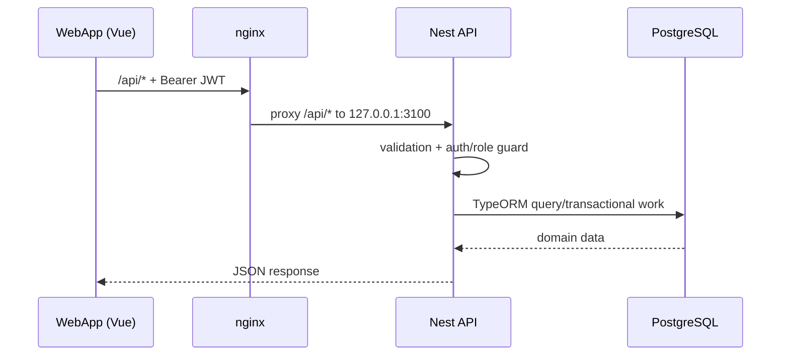
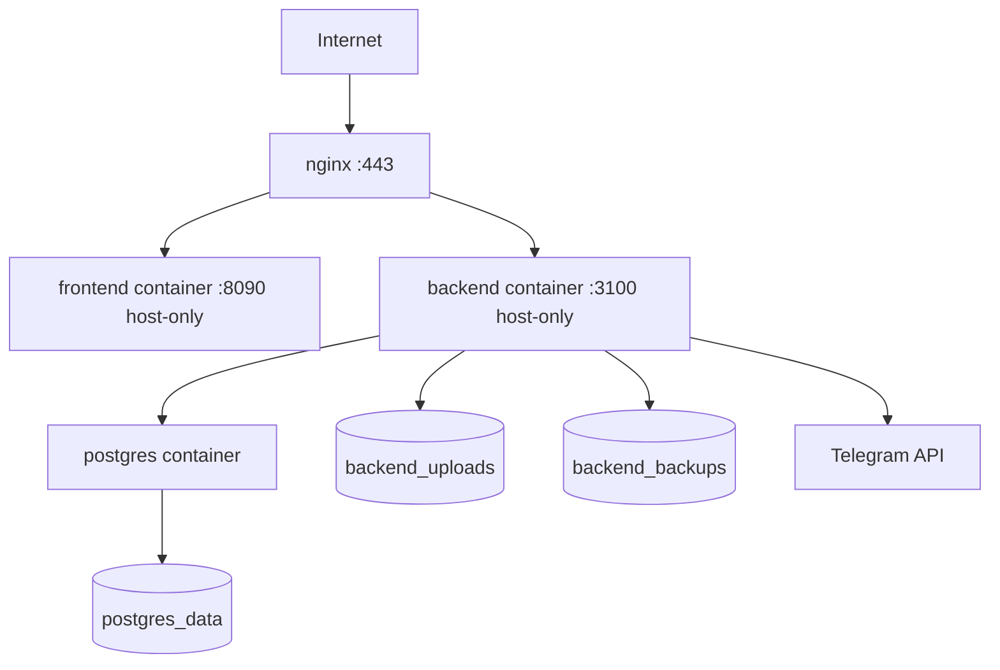

# Architecture

[[TechnicalDocument|← Core technical document]]

## Request paths

The Vue SPA is route-based and lazy-loads views. Its reusable behaviour lives in composables, notably authentication, Telegram WebApp integration, localization, theme/UI styling, admin-master selection, and app strings. The API client is `frontend/src/api/client.js`.

## API shape

`backend/src/main.ts` creates a Nest Express application, mounts every controller below `/api`, publishes uploaded files at `/api/uploads/`, and serves the built frontend from `frontend/dist` when present. CORS allows Telegram Web plus local Vite origins and the configured Mini App origin.

The root module starts scheduling and imports the domain modules. Modules use TypeORM repositories directly; there is no separate message queue or event bus in the checked-in system.

## Bot integration

The Telegraf bot is an application module rather than a separate service. It communicates with Telegram and calls domain services/repositories in the same Nest process. It is used for:

- booking and cancellation notices to masters;
- appointment reminders and re-engagement;
- post-session status actions and feedback collection;
- giveaway participation/winner notification;
- broadcasts and CRM chat messages.

This co-location makes bot/domain consistency straightforward, but it also means bot polling, API requests, and scheduled tasks share process availability.

## Deployment topology

Compose attaches all services to the dedicated `murrnails` network. PostgreSQL, frontend, and backend are published only to loopback on the host; nginx is intended to be the public entry point. Backend receives the Docker socket for container-based backups—treat that mount as privileged operational access.

## Frontend route families

| Family | Examples | Intended audience |
|---|---|---|
| Client | `/appointments`, `/appointments/book`, `/promo`, `/giveaways`, `/learning`, `/profile` | authenticated users |
| Shared | `/`, `/calendar`, `/my-stats`, `/inspiration`, `/updates` | authenticated users, with UI tailored by role |
| Master | `/admin/clients`, `/admin/services`, `/admin/availability`, `/admin/appointments`, `/admin/chat` | master or admin |
| Admin | `/admin/broadcast` | admin only |

Route metadata improves client navigation, but it is not authorization. The API guards must remain decisive.

## Cross-cutting design decisions

- PostgreSQL is the durable source of truth; most automation state is represented in domain tables.
- UUID primary keys are the standard for application entities.
- IDs linking related domain objects are commonly scalar columns rather than TypeORM relation objects; inspect services for join/ownership logic.
- TypeORM auto-loads entities. Development may synchronize schema automatically; production does not.
- Scheduled work is deliberately simple and in-process, appropriate for one API instance but requiring redesign for horizontally scaled workers.
