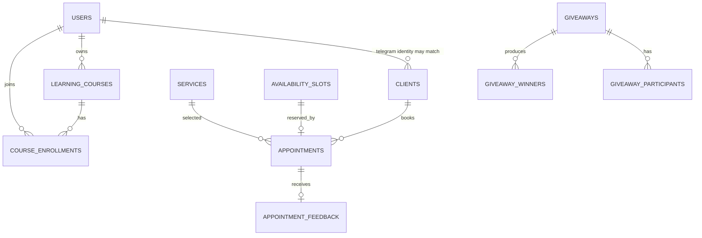

# Data Model

[[TechnicalDocument|← Core technical document]] · [[Operations]]

## Core relationships

## Table groups

| Group | Tables | Notes |
|---|---|---|
| Identity | `users`, `bot_instances`, `audit_log`, `app_strings` | User stores Telegram and optional password identity, roles, profile/preferences, calendar token and presence. Password hash is intentionally not selected by default. |
| CRM | `clients`, `services`, `availability_slots`, `appointments`, `appointment_feedback`, `monthly_expenses`, `custom_time_requests` | Operational booking data, master-owned by `masterId` where applicable. |
| Community | `showcase_works`, `client_photos`, `work_likes`, `work_like_boosts`, `suggestions`, `patch_notes` | Portfolio/feed and engagement data. |
| Messaging & automation | `bot_messages`, `chat_templates`, `scheduled_discount_broadcasts`, `master_summary_logs` | Conversation history, message templates, deferred jobs and summary delivery history. |
| Growth | `giveaways`, `giveaway_participants`, `giveaway_winners`, `learning_courses`, `course_enrollments` | Campaign and education features. |

## Important state fields

- **Appointment:** status enum, source enum, date/start/end times, master/client/service/slot IDs, price, promotion and reminder timestamps, session outcome/no-show notes.
- **Availability slot:** master/date/time window, active flag, discount price/promotion fields and reservation context.
- **Client:** contact fields, notes, no-show/LTV-related values, preference/re-engagement data, `masterId` ownership.
- **Giveaway:** active window, status, winners count, participation requirements and master owner; entries can be verified before drawing.
- **Course enrollment:** `pending_payment` → `confirmed` or `cancelled`.
- **Feedback:** one record per appointment, rating/comment/liked-options and public visibility.

## Ownership model

The dominant partition key is `masterId`. A master should see only their own services, clients, availability, appointments, content, and campaigns. Administrators may select/manage other masters. Client-facing queries use the authenticated Telegram-linked identity and booking/client records.

Because several relationships are represented by ID columns instead of formal relation properties, changes must preserve IDs and query filters explicitly. Do not infer cascading behaviour without reading the service and entity involved.

## Schema evolution

`getDatabaseConfig()` sets `synchronize` to true only when `NODE_ENV !== production`. In production, TypeORM will not create or modify tables automatically.

For every persistent change:

1. Update the entity and any DTO/service mapping.
2. Create an idempotent, reviewed SQL migration or deployment script.
3. Test it against a database snapshot before production.
4. Deploy the database change before code that requires the new shape (or make code backward compatible).
5. Confirm backup/restore works and update these notes.

> [!danger]
> Never use schema synchronization as a production migration strategy. Also avoid editing data dumps manually unless the restoring code has been verified.
