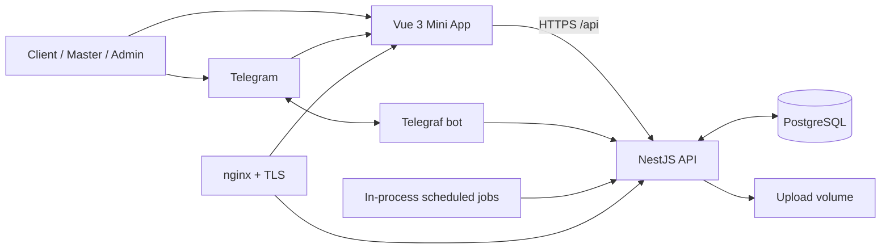

# MurrNails — Technical Document

> [!abstract]
> MurrNails is a Telegram-first CRM, booking, and community application for service professionals. It combines a Vue 3 Telegram Mini App, a NestJS HTTP API and Telegram bot, PostgreSQL persistence, scheduled automation, and a Docker/nginx production deployment.

## Start here

| Need | Read |
|---|---|
| Understand the system and module boundaries | [[Technical Notes/Architecture]] |
| Call or change an endpoint | [[Technical Notes/API Reference]] |
| Understand persistent data | [[Technical Notes/Data Model]] |
| Run, deploy, back up, or troubleshoot | [[Technical Notes/Operations]] |
| Reason about sign-in and access | [[Technical Notes/Security and Access]] |

## Product boundary

The product serves three principal roles:

- **Client** — books a service, manages a profile, sees appointments/promo/community content, takes part in giveaways, and receives bot messages.
- **Master** — operates a personal CRM: clients, services, availability, appointments, promotion, statistics, content, and follow-up.
- **Admin** — has master capabilities across masters plus user/role management, broadcasts, and global oversight.

Telegram is both a launch surface and a communication channel. The Mini App is not the only interface: the bot delivers reminders, collects feedback, supports giveaways, and handles post-session actions. Password authentication also exists so the app can be used outside a Telegram launch context.

## System at a glance



### Runtime components

| Component | Implementation | Responsibility |
|---|---|---|
| Mini App | Vue 3, Vite, Vue Router, Tailwind | Responsive user interface, Telegram WebApp integration, JWT-bearing API calls. |
| API | NestJS 11, TypeORM | Domain rules, authorization, REST API, static uploads, orchestration. |
| Bot | Telegraf | Telegram updates, reminders, feedback and interactive actions. |
| Database | PostgreSQL 16 | Application’s durable system of record. |
| Scheduler | `@nestjs/schedule` + an interval service | Reminders, post-session follow-ups, daily backups, summaries, delayed promotions. |
| Edge/deployment | Docker Compose, nginx | Container lifecycle, localhost-only service ports, TLS termination and reverse proxying. |

> [!warning] Redis discrepancy
> The historical README names Redis, but the current `docker-compose.yml` contains only PostgreSQL, backend, and frontend services. Treat Redis as **not part of the checked-in active deployment** unless a separate environment adds it.

## Repository map

```text
murrnails-app/
├── frontend/                 Vue Mini App
│   └── src/{views,components,composables,api,router}
├── backend/                  NestJS application
│   └── src/{auth,bot,crm,appointments,...}
├── deploy/nginx.conf         production reverse proxy
├── docker-compose.yml        service topology and persistent volumes
├── dev.sh                    local developer helper
└── docs/                     project-local implementation notes
```

The authoritative code is outside this Obsidian vault at `Documents/murrnails-app`; this vault records its architecture and operating knowledge. When behaviour conflicts with this document, code and the live environment take precedence.

## Backend domain map

| Module | Owns |
|---|---|
| `auth` | Telegram/password auth, user profile, roles, JWT, broadcast |
| `bot` | Telegram bot commands, callbacks, outbound messaging |
| `crm` | clients, services, availability, master appointments, promotion, analytics, showcase, reviews, photos |
| `appointments` | client-facing booking, appointments, likes, personal stats and profile |
| `custom-time-requests` | client-requested off-calendar time windows |
| `giveaways` | giveaway lifecycle, entries, verification, draws, winners |
| `chat` | bot conversation history, templates, inbox actions |
| `learning` | courses and enrollments |
| `backup` | on-demand/automatic PostgreSQL dump and restore |
| `calendar` | tokenised iCalendar feed |
| `summary` | master summaries and delivery log |
| `admin` | content strings, audit log, bot-instance metadata |
| `suggestions`, `patch-notes` | feedback backlog and product updates |

## Critical business flows

### Booking

1. A signed-in client chooses a master, service, and free availability slot.
2. `POST /api/appointments/book` validates the request and creates an appointment linked to the client, master, service, and slot.
3. The bot informs the master; appointment automation later sends client reminders.
4. A master can also create/edit/cancel appointments directly from CRM, including manual and alternative bookings.

**Invariant:** availability, appointment ownership, and appointment status must be checked server-side; the client UI is never the source of truth. See [[Technical Notes/API Reference#Appointments and booking]].

### Session completion and feedback

1. After a scheduled session’s end time, automation asks the master through Telegram whether it occurred.
2. The master can mark it done, move it, cancel it, or flag a no-show.
3. Completed sessions can trigger a client feedback conversation; submitted feedback becomes an `appointment_feedback` record and may be displayed publicly according to its visibility flag.

### Promotion

1. A master discounts an availability slot and may request an immediate promotion preview/send.
2. The CRM can queue a second discount broadcast.
3. The in-process interval checks due `scheduled_discount_broadcasts` every five minutes and deletes each row after processing.

### Content and community

Showcase work and client work are surfaced in feeds. Likes are stored per user/work while manual boosts support editorial counts. Learning courses are master-owned and enrollments move through `pending_payment`, `confirmed`, or `cancelled`.

## Interface and data conventions

- Every HTTP route is prefixed with `/api`; `/api/health` is the basic health endpoint.
- Nest’s global validation pipe transforms inputs, strips unknown properties, and rejects unrecognised fields.
- Protected API requests use a JWT bearer token. Route guards add authentication and role/ownership checks.
- Dates and times are often persisted separately (`date`, `startTime`, `endTime`), so callers must preserve the intended business timezone. Read [[Technical Notes/Operations#Time and timezone]].
- Uploads are exposed from `/api/uploads/*`; nginx permits bodies up to 25 MB, matching the application’s upload use cases.

## Technical risks worth remembering

> [!danger] Production schema changes
> TypeORM `synchronize` is enabled outside production and disabled in production. There is no general migration framework visible in the repository; schema changes therefore need an explicit SQL migration/deployment plan. See [[Technical Notes/Data Model#Schema evolution]].

> [!warning] Single-process jobs
> Reminders, backup, and delayed-promotion processing run in the API process. Running multiple backend replicas can duplicate jobs unless coordination is introduced.

> [!warning] Secrets
> `TELEGRAM_BOT_TOKEN`, `JWT_SECRET`, database credentials, OneDrive refresh tokens, and SMTP credentials are runtime secrets. Keep them in `backend/.env` or the deployment secret store; never put production values in the vault or repository.

## Development and verification

The normal local path is:

```bash
docker compose up -d postgres
cd backend && npm install && npm run start:dev
cd frontend && npm install && npm run dev
```

For the production-shaped stack, build/run all Compose services. More exact commands, URLs, environment variables, backups, and recovery are in [[Technical Notes/Operations]]. Backend tests use Jest; frontend build uses `npm run build`.

## Source-of-truth checklist

Before changing a domain behaviour, inspect in this order:

1. Its controller and DTO for public contract and validation.
2. Its service for authorization and state transitions.
3. Its entity and related entities for persistence implications.
4. The corresponding Vue view/composable for UX assumptions.
5. Any bot handler or scheduled service that also changes the same data.

## Related implementation documents

- Existing repository docs: `murrnails-app/README.md`, `backend/README.md`, `backend/TIMEZONE.md`, `docs/calendar-sync.md`, and `deploy/README.md`.
- This vault: [[Technical Notes/Architecture]], [[Technical Notes/API Reference]], [[Technical Notes/Data Model]], [[Technical Notes/Operations]], and [[Technical Notes/Security and Access]].
